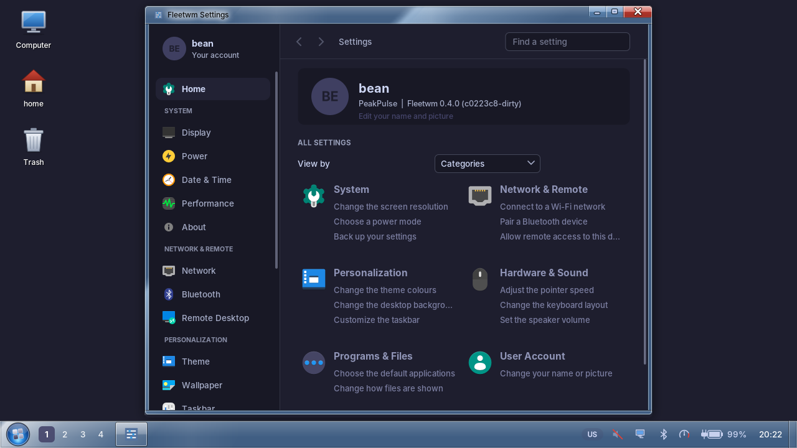
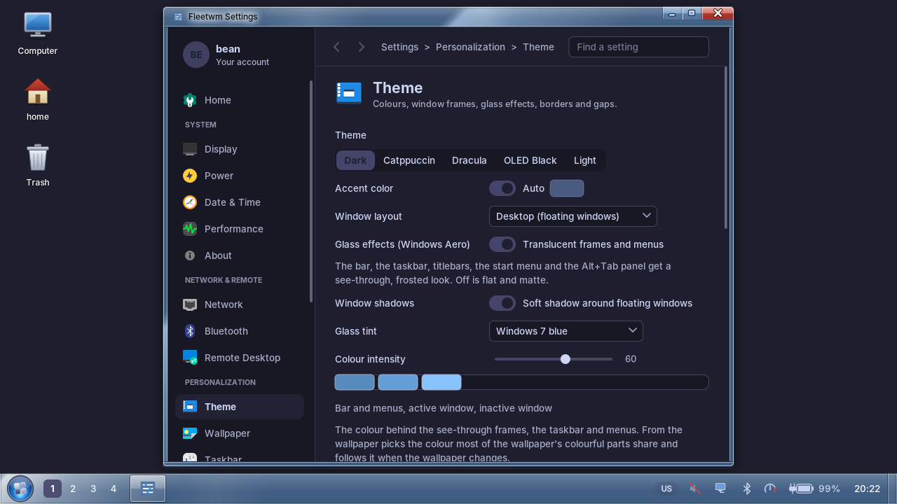
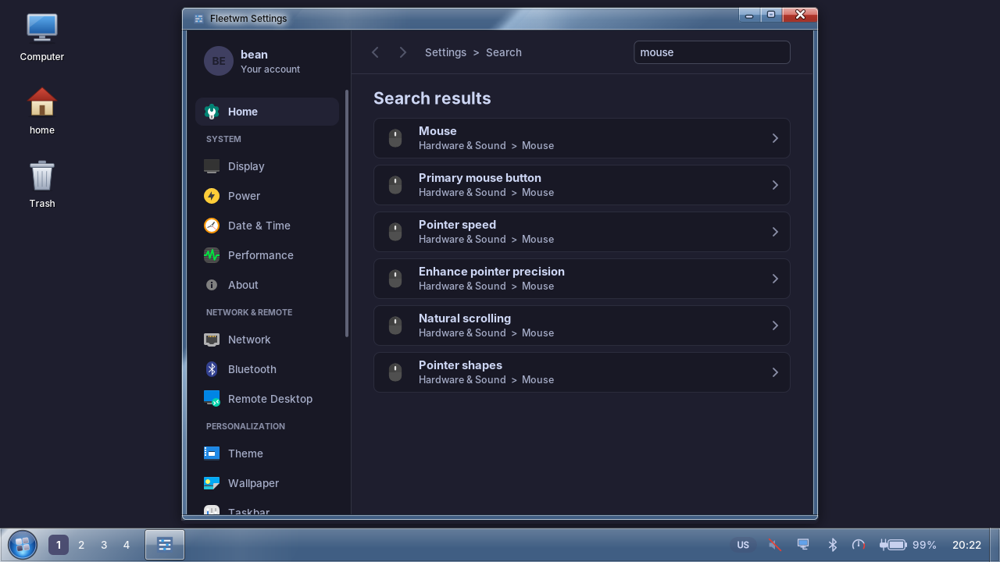

# Settings (fleetwm-settings)

One window for every setting, laid out from three references:

| Taken from | What |
|---|---|
| **Windows 11 Settings** | a search box at the top ("Find a setting"), a Home page that opens with who you are and your most recent pages, a profile card at the top of the sidebar, rounded cards with a chevron |
| **macOS System Settings** | a grouped sidebar with an icon per page, and a title with its icon and a one-line description at the top of every page |
| **The classic Control Panel** | the category view of Home (big icon, the category as a link, the two or three common jobs under it), **View by** Categories / Large icons / Small icons, back and forward buttons, a breadcrumb that shows where you are |

Looked at on 2026-10-26: the Windows 11 Settings, macOS System Settings and Windows 11 Control Panel screenshots on the Wikipedia pages "Settings (Windows)", "System Settings" and
"Control Panel (Windows)", and the category lists in their text (Windows 11: Home, System, Bluetooth & devices, Network & internet, Personalization, Apps, Accounts, Time & language, Gaming,
Accessibility, Privacy & security, Windows Update; macOS Ventura replaced the icon grid by a scrolling sidebar and a detail view; the Control Panel has had a Category view since Windows Me).
Nothing was copied: the layout, names and icons are Fleetwm's own, built from the same ideas.

## Layout

- **Sidebar**: the profile card (opens *Your account*), then Home and the pages grouped into System, Network & Remote, Personalization, Hardware & Sound, Programs & Files. It has a scrollbar (drag it, or use the wheel and the Up/Down keys, which skip the group headings).
- **Header**: back and forward (the pages you opened, like a browser), a breadcrumb (`Settings > Personalization > Theme`) and the search box. Typing lists matching settings with the page they are on; Enter opens the best match; picking a page clears the search.
- **Home**: a banner with your name, the computer's name and the Fleetwm version (click to edit your name and picture), your recent pages, then **All settings** in the view you chose (kept between runs).
- **Every page** starts with its icon, name and a one line description, then the page's own controls.

## Where things are defined

| What | File |
|---|---|
| Pages, categories, descriptions, icons, the Home task links, the search index, the recent-page and view state | `src/common/settings_catalog.{hpp,cpp}` (unit tests: `tests/test_settings_catalog.cpp`) |
| The window: sidebar, header, Home, search page, the pages | `apps/settings/main.cpp` (network, Bluetooth, keyboard and remote desktop pages in their own `*_tab.hpp`) |
| Grouped navigation with a scrollbar, clickable tiles, free layout helpers | `src/fleetkit/ui.{hpp,cpp}`: `Ui::nav_entries`, `Ui::tile`, `Ui::reserve`, `Ui::set_cursor` |

State is in `~/.local/state/fleetwm/settings-ui.txt` (`view=categories|large|small`, `recent=` page numbers). `fleetwm-settings --page NAME` opens a page (a prefix of its name is enough), `--search TEXT` opens with a search.

**Adding a setting**: put the control in its page's code, add one line to `kIndex` in `settings_catalog.cpp` (the name people will look for, and the words they might type) so the search finds it. **Adding a page**: add it to the `SettingsPage` enum, `settings_pages()` (name, description, icon name, category), the category's `pages`, the drawing `switch` in `Settings::draw`, and `SETTINGS_PAGES` in `scripts/pgo-train-session.sh`; the tests fail until each is consistent.

Icons are the icon theme's (the one GTK is set to, `Inherits` followed); a page whose icon the theme does not have shows a coloured tile with its first letter, so nothing is blank on a machine without an icon theme.

## Checking how it looks without touching your screen

`scripts/headless-shot.sh BUILD_DIR OUT.png fleetwm-settings --page theme` runs the program in a private headless compositor and saves a screenshot of that, never of your own screen (`SHOT_CFG` and `SHOT_WAIT` in the script's header). The pictures above were made with it.

## Open

- Dragging the sidebar scrollbar with a real mouse has not been tried (the wheel, the keys and the thumb's drawing were checked); the Home page and search with a real pointer likewise.
- The pages themselves are unchanged: only their header is new. A page-by-page pass in the same style (grouped rows in rounded cards like the macOS lists) is the next step.
- Search covers settings by name and keywords, not the text of every label; the Remote Desktop page grew in the same round and was not looked at at 1024x768 (the window is 810 px wide, so it fits, but its rows are long).
